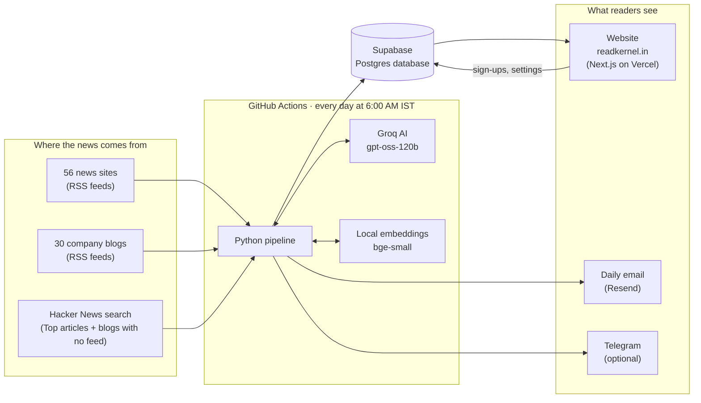
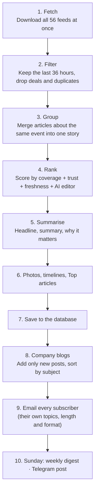

# ReadKernel at a glance

The short version: what ReadKernel is, what happens every morning, and what it's built with.
For the full story, with the reasons behind every choice, read [TECHNICAL_GUIDE.md](TECHNICAL_GUIDE.md).

---

## What it is

A **free daily tech and AI news brief** at [readkernel.in](https://readkernel.in).

Every morning it reads **56 news sites** and **30 company engineering blogs**, merges
articles about the same event into one story, ranks them, writes a short summary for
each, and publishes the result as a website, a daily email and (optionally) a Telegram post.

**It costs nothing to run.** Every service used is on a free tier, and the AI is an
open-weight model on Groq's free plan.

---

## The whole system on one page



---

## What happens every morning



| Step | In one line |
| --- | --- |
| **Fetch** | Reads the free RSS "notice board" each site publishes. A broken site is skipped, not fatal. |
| **Filter** | Keeps the last 36 hours and drops deals, coupons, promos and repeated links. |
| **Group** | A small AI model on the computer spots look-alike headlines. Groq double-checks the unclear ones. |
| **Rank** | More outlets + more trusted outlets + newer = higher. An AI "editor" nudges each story up or down. |
| **Summarise** | Groq writes the headline, a 2–3 sentence summary and "why it matters". Each story is summarised once and remembered. |
| **Photos** | The publisher's own preview photo (the one WhatsApp shows), loaded from their site with credit. |
| **Timelines** | Links today's story to the same ongoing story on earlier days ("This story so far"). |
| **Top articles** | The most-upvoted Hacker News posts of the day, one line each. |
| **Company blogs** | New engineering posts only (never saved twice), sorted into 7 subjects, rated for depth. |
| **Email** | Each reader gets their own picks, plus one company blog read unless they turned it off. |

---

## The building blocks

| Part | What we use | Why, in one line |
| --- | --- | --- |
| **Pipeline language** | Python 3.12 | Best tools for reading feeds and working with AI. |
| **Main AI** | Groq · `openai/gpt-oss-120b` (open-weight) | Free, fast and good enough to write clean summaries. |
| **Backup AI** (off) | Claude Haiku 5.5 or GPT-5 mini | Paid; one setting switches to them if Groq ever fails. |
| **Duplicate finder** | `BAAI/bge-small-en-v1.5` via fastembed | Runs free on the computer, so grouping costs no AI calls. |
| **Database** | Supabase (Postgres), Tokyo region | Free, real SQL, built-in security rules and full-text search. |
| **Website** | Next.js 16 + React 19 + Tailwind CSS 4 | Fast pages, cached, easy to host free. |
| **Hosting** | Vercel | Free, rebuilds the site automatically on every `git push`. |
| **Domain** | readkernel.in (GoDaddy, DNS on Vercel) | Own name; also needed to send email from our own address. |
| **Daily robot** | GitHub Actions (cron `30 0 * * *`) | Free scheduler that runs the pipeline at 6:00 AM IST. |
| **Email** | Resend, from `brief@readkernel.in` | Free 3,000/month; lands in inboxes better than Gmail. |
| **Replies** | Go to `readkernel.brief@gmail.com` | The domain address can send but has no inbox. |
| **Chat channel** | Telegram bot (optional) | Free; posts the brief once a bot token is added. |

**Monthly cost: ₹0.** The only paid item is the domain (about ₹899 a year after the first year).

---

## Where things live

```
readkernel/
├── pipeline/            Python: everything that runs at 6 AM
│   ├── sources.yaml         the 56 news sites
│   ├── company_blogs.yaml   the 30 company blogs
│   ├── kernel/              one file per step (fetch.py, group.py, rank.py ...)
│   └── tests/               43 automatic checks
├── web/                 Next.js website (readkernel.in)
├── db/migrations/       5 SQL files that create the database tables
├── docs/                these documents
└── .github/workflows/   the 6 AM schedule
```

---

## What's built and what's next

| Built and live | Next (iteration 2) |
| --- | --- |
| Daily brief, full feed, topic pages, Top articles | Chrome new-tab extension |
| Company blogs with subjects and depth rating | MCP server, so AI assistants can read ReadKernel |
| Personal email (topics, 5/10/15, format, daily/weekly) | Google sign-in (built, needs switching on) |
| Archive, search, story timelines, saved stories | Telegram channel (built, needs a bot) |
| Blog, guides, newsletter reviews, legal pages | |
